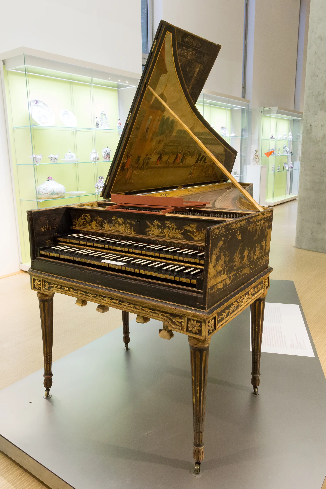
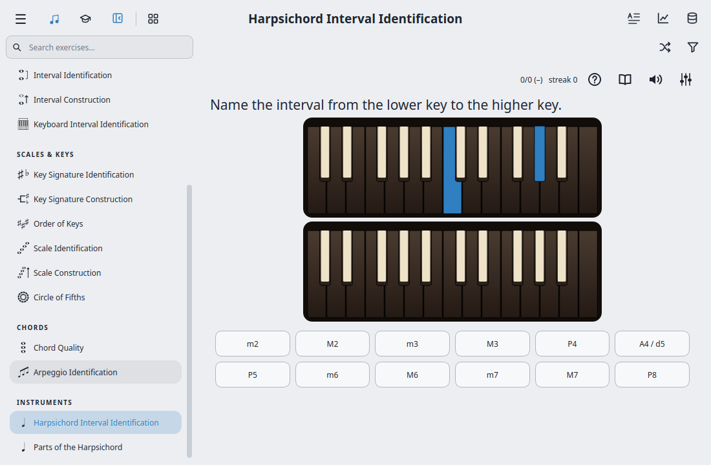
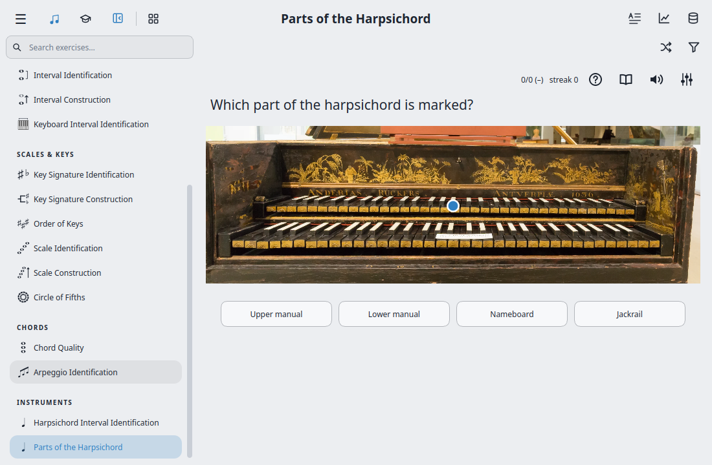
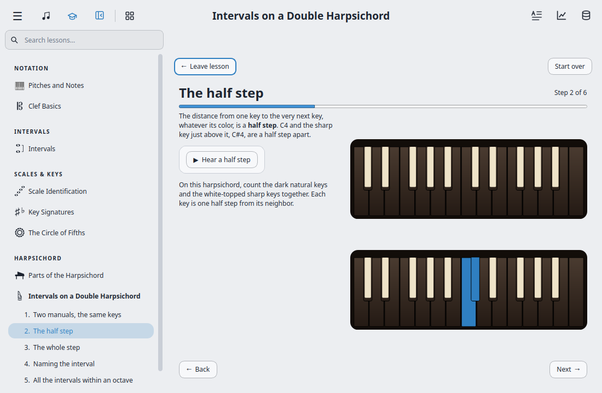
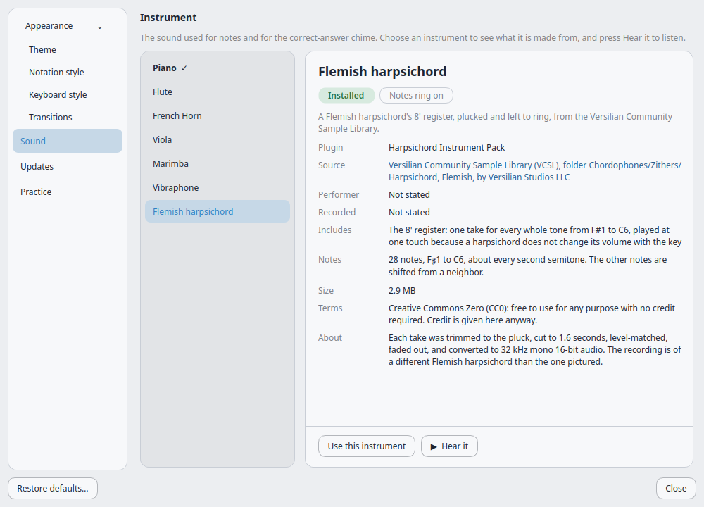

# Harpsichord for Alto

<p align="center">
  
</p>

Train your ear and your eye on a Flemish double harpsichord. This plugin adds a two-manual harpsichord to
[Alto](https://github.com/altosaurus/alto), the music theory trainer: you name the interval between two highlighted keys, hear
them plucked together, and learn the parts of the instrument from photographs of a real one. It is free, and it works offline.

**What you get**

- An interval exercise on two drawn manuals, with a range you can drag, a choice of intervals, and a choice of manuals.
- A parts exercise with 16 marked parts on five photographs.
- Two lessons with knowledge checks, and 14 glossary entries.
- A Flemish harpsichord sound, from F♯1 to C6, that you can also use as Alto's sound everywhere.

<p align="center">
  <a href="https://github.com/altosaurus/harpsichord-plugin-tutorial/releases/latest/download/harpsichord.zip"><b>Download harpsichord.zip</b></a>
</p>

## Name the interval between two keys

**Harpsichord Interval Identification** highlights two keys and asks for the interval between them. Alto draws the two
manuals itself, in dark wood with bone-topped sharps, so the keys stay sharp at any size. Both highlighted keys can sit on the
same manual or one on each, and a correct answer plucks the two notes together, as a chord.

<picture>
  <source media="(prefers-color-scheme: dark)" srcset="docs/assets/img/plugin-harpsichord-intervals-dark.png">
  
</picture>

Set the exercise up from its settings:

- **Range.** Drag a small keyboard to choose the keys you want to practice. The big manuals redraw as you drag, and a new
  question comes when you pause. Start with an octave or two, then open it up as far as E1 to F6.
- **Intervals.** Ask only the intervals you are working on, from a minor second to an octave. An interval too wide for your
  range is greyed out.
- **Manuals.** Check **Upper manual** or **Lower manual** to keep both highlighted keys on that manual, or check both to
  include questions with one key on each.
- **Harpsichord sound.** Choose which instrument plays. See [Choose the sound](#choose-the-sound).

## Learn the parts of the harpsichord

**Parts of the Harpsichord** marks one part at a time on a photograph and asks you to name it: the lid, prop stick, legs,
upper and lower manuals, nameboard, jackrail, cheek, apron, natural and sharp keys, tuning pin, damper, wrest plank, bentside
and spine. The pictures are of a double harpsichord built by Andreas Ruckers in Antwerp in 1636 and rebuilt in Paris by Pascal
Taskin in 1787, which belongs to the Museum für Kunst und Gewerbe Hamburg. Small parts are shown close up.

<picture>
  <source media="(prefers-color-scheme: dark)" srcset="docs/assets/img/plugin-harpsichord-parts-dark.png">
  
</picture>

## Two lessons

Lessons walk you through a topic one step at a time, with a picture, a short explanation, a button to hear the notes, and a
knowledge check you answer by clicking.

- **Parts of the Harpsichord.** Six steps from the whole instrument to the lid, the keyboards, the nameboard and jackrail, the
  inside of the case, and the legs.
- **Intervals on a Double Harpsichord.** Six steps on why the two manuals share the same keys, the half step and whole step,
  naming an interval, every interval within an octave, and intervals across the two manuals. The keys are highlighted on the
  drawn manuals as you go.

<picture>
  <source media="(prefers-color-scheme: dark)" srcset="docs/assets/img/plugin-harpsichord-lesson-dark.png">
  
</picture>

Fourteen glossary entries explain the terms you meet, from *harpsichord* and *double harpsichord* to *nameboard*, *jackrail*
and *damper*. Each one links to the exercises and lessons that use it.

## Choose the sound

The plugin adds **Flemish harpsichord** to Alto's sound settings. Open **Menu → Settings → Sound**, select it, and press
**Hear it** to listen. Choose **Use this instrument** to hear the harpsichord for notes in every other exercise as well.

<picture>
  <source media="(prefers-color-scheme: dark)" srcset="readme/harpsichord-sound-dark.png">
  
</picture>

The interval exercise has its own sound row in its settings. It opens a list with this plugin's harpsichord first, then any
other harpsichords you have installed, then every other instrument, so you can compare recordings from different plugins
without leaving the exercise.

## Install

You need Alto with plugin support.

1. [Download `harpsichord.zip`](https://github.com/altosaurus/harpsichord-plugin-tutorial/releases/latest/download/harpsichord.zip)
   from the latest release.
2. In Alto, open **Menu → Tools → Plugins…** and choose **Install plugin from file…**.
3. Select the ZIP and restart Alto.
4. Open **Instruments** in the sidebar. **Harpsichord Interval Identification** and **Parts of the Harpsichord** are there,
   and the lessons and glossary entries appear in **Lessons** and **Glossary**.

To remove it, open the same dialog and uninstall **Harpsichord Instrument Pack**. Your practice history is kept.

## Build your own

This repository is also the tutorial for making a plugin for a keyboard instrument like this one. It starts from the example's
photograph and recordings, draws two manuals, builds an interval exercise with a range, intervals, manuals and a sound choice,
and then adds a picture question about the parts, a lesson and a glossary entry.

| Path | Contents |
| --- | --- |
| `docs/plugins/harpsichord.md` | The tutorial. It still uses Alto's site front matter and `relative_url` links. |
| `docs/assets/plugins/harpsichord/` | The editable example pack: `pack.json`, photographs, icons, recordings, and `CREDITS.txt`. |
| `docs/assets/img/plugin-harpsichord-*.png` | The three screenshots the tutorial shows, each in a light and a dark theme. `scripts/screenshots.py` makes them from a checkout of Alto. |
| `readme/` | The sound settings picture on this page only. |
| `.github/workflows/release.yml` | Builds `harpsichord.zip` from the pack folder and publishes it as a release asset. |

The Alto docs website brings in `docs/plugins/harpsichord.md` and only the files that page refers to. The loose sound files and
everything else stay in this repository. Push a change here, then run Alto's **Docs** workflow to update the site.

The install file is not stored here. Push a tag such as `v1.0.0` and the Release workflow builds `harpsichord.zip` from the pack
folder, checks that `pack.json` is at its root and that every file it names is there, and publishes a GitHub release with the ZIP
attached. To build it yourself, for a test install, zip the folder's contents:

```sh
cd docs/assets/plugins/harpsichord && zip -X -D -r /tmp/harpsichord.zip .
```

The paths match Alto's `docs/` folder, so a file here can be compared with its original. The plugin API reference stays in Alto
at `docs/plugins/api.md`.

## Credits and licenses

The recordings are from the [Versilian Community Sample Library](https://github.com/sgossner/VCSL) (VCSL) by Versilian Studios
LLC: the 8′ register of its Flemish harpsichord, one take for every whole tone from F♯1 to C6. VCSL is released under
[CC0 1.0](https://creativecommons.org/publicdomain/zero/1.0/), so no credit is required, though the pack gives it. Each take was
trimmed to the pluck, cut to 1.6 seconds, level-matched, faded out, and converted to 32 kHz mono. The recordings are of a
different Flemish harpsichord than the one in the pictures. The files in `sounds/` are named after the pitch, and
`docs/assets/plugins/harpsichord/CREDITS.txt` lists the original take for each.

The photographs are by Rainer Halama for Wiki Loves Music, from the Wikimedia Commons category "Taskin harpsichord (1787,
MKG)", and are released under CC0 1.0. They were scaled down and converted to WebP. The keyboards in the interval exercise are
drawn by Alto and need no photograph.

Keep `CREDITS.txt` with the recordings and pictures wherever you share them.

## License

The tutorial, the manifest and the other original files in this repository are released under the [MIT License](LICENSE).
The recordings and the photographs are not covered by it. Both are CC0 and keep that status, as described under
[Credits and licenses](#credits-and-licenses).
